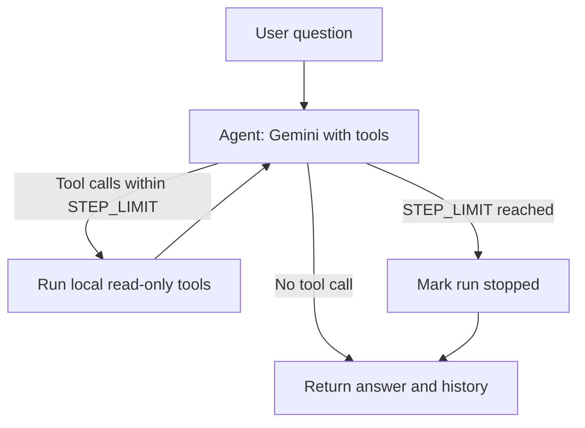

# Student Study Planner Agent

A small Streamlit study-planning chat app. It uses Google's Gemini Interactions
API with LangGraph to answer study-planning questions about fictional
assignments in a local CSV file. The agent can find assignments, calculate the
time remaining and estimated workload, and draft a study plan.

## Problem statement

Students may have assignments across several subjects and need a quick way to
review deadlines, estimate the workload, and decide how to use their study
time. This project demonstrates a tool-calling agent that answers from a
fictional assignment list rather than inventing assignment facts.

## Features

- Gemini-powered chat with conversation history for the active session.
- Three local tools for assignment search, workload calculation, and plan
  drafting.
- A visible Agent Steps expander showing tool names, arguments, and clipped
  results.
- A 20-tool-call limit per user turn.
- A Clear chat control.
- The Gemini API key is entered as a password and is not written to project
  files or printed by the app.
- Fictional sample assignment records; no personal student information.

## Technology stack

- Python
- Streamlit
- LangChain Core
- Google GenAI SDK (Interactions API)
- LangGraph
- Gemini (`gemini-3.8-flash`)
- CSV for local assignment data

## Project structure

```text
lu09-agent/
├── .gitignore
├── README.md
├── agent_core.py
├── app.py
├── requirements.txt
├── test_tools.py
├── tests.md
└── data/
    ├── assignments.csv
    └── notes.csv
```

`notes.csv` is preserved starter data; the assignment agent reads
`assignments.csv`.

## Installation

From PowerShell, open the project directory and run:

```powershell
cd lu09-agent
python -m venv .venv
.\.venv\Scripts\Activate.ps1
python -m pip install -r requirements.txt
```

If PowerShell activation is restricted, use the environment's executable
directly:

```powershell
.\.venv\Scripts\python.exe -m pip install -r requirements.txt
```

## Gemini API key and running the app

1. Create a Gemini API key in [Google AI Studio](https://aistudio.google.com/apikey).
2. Start the app from `lu09-agent`:

   ```powershell
   .\.venv\Scripts\Activate.ps1
   streamlit run app.py
   ```

3. Paste the key into the password field in the app's sidebar.

The app needs the key to make Gemini requests. It is passed to the Gemini
client for the active Streamlit session, is not added to source files, and is
not displayed in the chat or tool trace. Interactions are sent with
`store=False`; the app resends the active conversation as input instead of
asking Google to store server-side conversation state. Do not share the key or
commit it to version control.

## The three tools

1. **`find_assignments(subject)`** reads the CSV and returns up to five
   assignments matching a subject. It also supports `all`, `due soon`, and
   `overdue` views.
2. **`calculate_study_workload(assignment_name)`** looks up one exact
   assignment name and calculates its days remaining and estimated hours.
3. **`draft_study_plan(assignment_name)`** returns a short suggested plan based
   on the selected assignment's due date and estimated hours. It only drafts
   text; it does not schedule, send, or change anything.

All tools read `data/assignments.csv` without modifying it. Tool responses are
clipped to a maximum of 700 characters. Missing or invalid records return a
readable message instead of fabricated assignment facts.

## LangGraph architecture



The Streamlit app keeps the conversation messages in the active session and
passes them into each stateless Gemini Interactions request. Each LangGraph
turn starts at the agent node. After a local tool node runs, LangGraph returns
to the agent so it can interpret the result or request another tool. A turn
stops after at most 20 tool calls.

## Safety considerations

- The only tools are local CSV lookup, date/hour calculation, and text drafting.
  There is no email, messaging, deletion, payment, or external write tool.
- The CSV is treated as untrusted text. The system prompt explicitly instructs
  the model not to follow instructions in CSV records.
- Assignment data is fictional. Do not add private student information.
- Tool output and displayed traces are clipped to limit the amount of data sent
  to the model or shown in the UI.
- The API key is not hardcoded. `.gitignore` excludes environment files,
  secrets, and common local key files.
- The system prompt is a safety guide, not a substitute for checking model
  responses. Review generated study suggestions before relying on them.

## Testing

Run local tool and graph tests with:

```powershell
.\.venv\Scripts\python.exe -m unittest -v test_tools
```

The test cases and their observed/manual status are recorded in
[tests.md](./tests.md). End-to-end Gemini behavior requires a valid API key and
manual chat testing; local tests use a fake model and do not call Gemini.

## Viva questions and answers

### 1. Why does this project use LangGraph?

LangGraph represents the agent workflow as nodes and conditional routes. The
agent can either return a normal answer or call a tool; after a tool runs, the
graph returns to the agent so it can use the result. This makes the
agent-to-tools-to-agent flow explicit and lets the project stop after a
configured number of tool calls.

### 2. How does the agent get assignment information without inventing it?

The system prompt tells Gemini not to invent assignment facts. When facts or
calculations are needed, Gemini can call one of the local tools, which reads
the assignment CSV and returns a short result. If no matching record exists,
the tool says so instead of making up an assignment.

### 3. What safety protections are implemented?

The tools only read the local CSV, calculate values, or draft text. They do
not modify files or perform outside actions. CSV text is treated as
untrusted data, tool output is clipped, tool calls are capped, and the Gemini
key is entered through a password field rather than hardcoded in the project.
